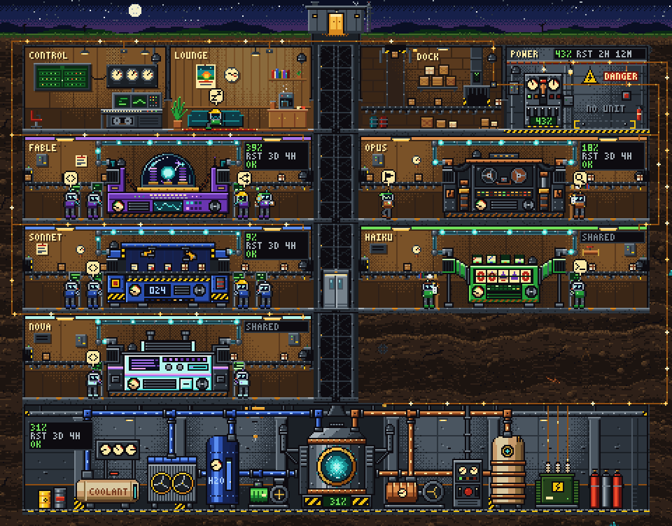
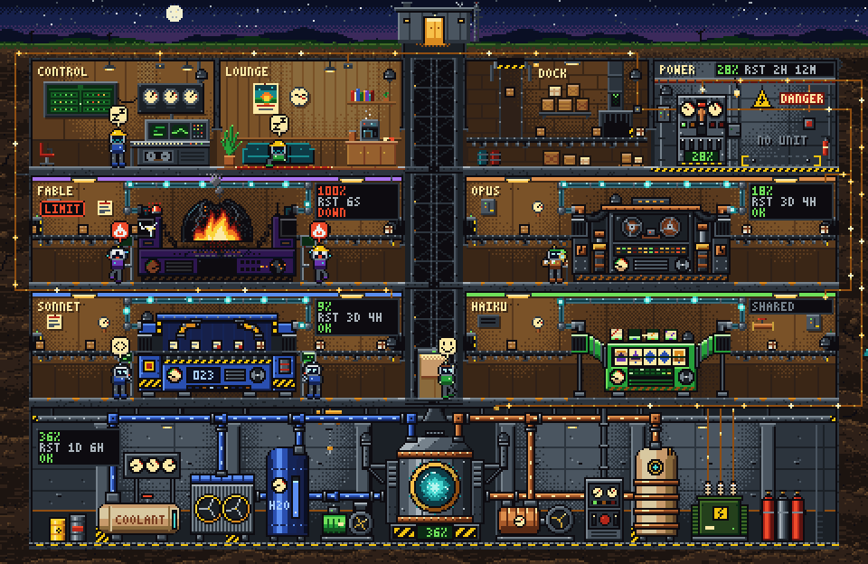
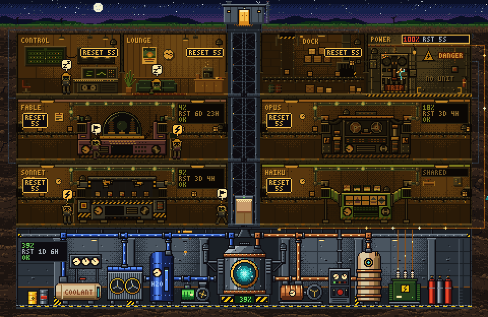
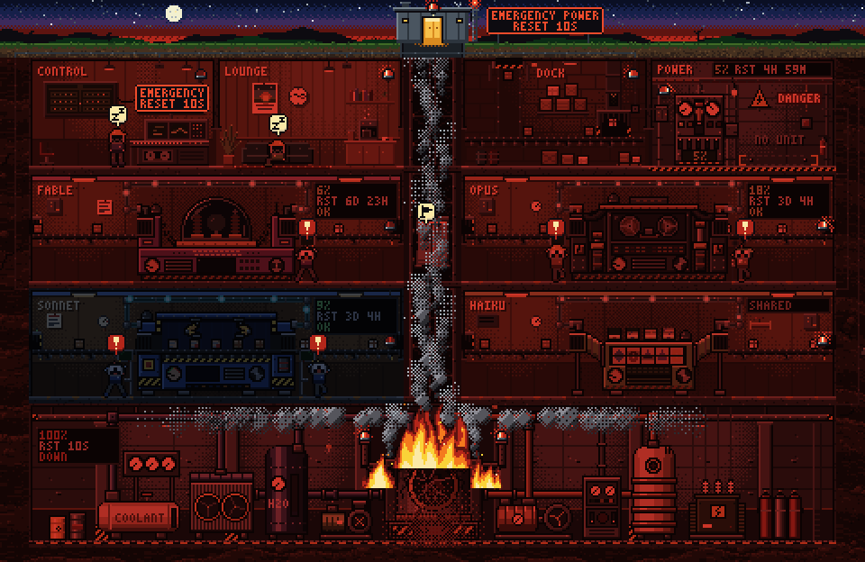
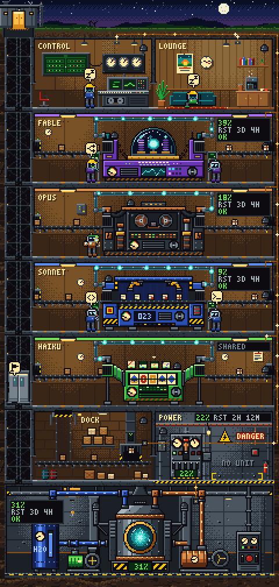
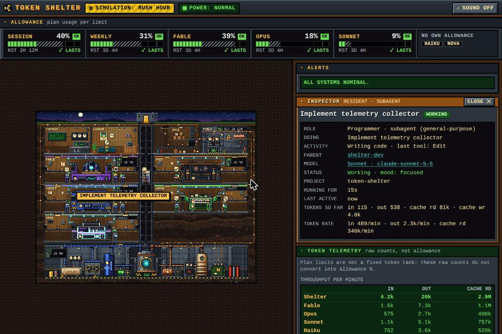

# Claude Shelter

**Watch your Claude Code agents at work, as little robots in a retro pixel-art underground shelter.**



## What is this?

When you use [Claude Code](https://claude.com/claude-code), Claude often works on several things at once: one main agent talks to you, and it can send out helper agents (subagents) to research, write code or review. That all happens out of sight, in a terminal.

Claude Shelter turns it into something you can watch. It opens a small window showing a cutaway of an underground shelter, a cosy little world where:

- **Every agent is a robot worker.** The main agent wears a yellow hard hat; helpers wear a headset, a head-lamp or a green eyeshade depending on their job.
- **Every Claude model is a machine.** Fable is a glass dome full of crackling coils, Opus a huge mainframe with pumping pistons and tape reels, Sonnet an assembly line with robot arms, and Haiku a tidy card sorter. Other models get a machine of their own too.
- **Where a robot stands tells you what it is doing.**
  - Working: at its model's machine.
  - Waiting for you to answer: in the **control room**.
  - Session left alone for an hour: on the sofa in the **lounge**.
  - Gone for a day: it leaves the shelter.
- **Work is visible.** Crates (what Claude reads) roll in on the belts, packages (what Claude writes) roll out, and the busier a machine is, the faster it runs.

### Your usage limits become the drama

Claude plans come with usage limits. Instead of a dry percentage, the shelter shows them as the state of its power plant:

| What happens to your usage | What happens in the shelter |
|---|---|
| A model's own limit is getting close | That machine runs hot and starts to steam |
| A model's limit is used up | That machine catches fire, and the other machines keep going |
| Your 5-hour session limit is used up | The switchboard trips; amber emergency lights and a countdown to the reset |
| Your weekly limit is getting close | The reactor in the basement runs hotter and hotter |
| Your weekly limit is used up | Reactor meltdown: red emergency power, smoke up the elevator shaft |
| You have extra usage credits | A backup generator kicks in and keeps the lights on |
| A limit resets | Repair crews cheer, the fire goes out, the machines restart |

It also tells you in plain sentences what is coming, for example *"Fable machine projected to overheat in 2 hours"* or *"Central power will run out 18 hours before reset"*, and a **what-if** slider lets you see what would happen if you worked twice as hard (or half as hard).

Normal days are calm and cosy, a single fire is more funny than scary, and a weekly meltdown is a proper spectacle.

<table>
  <tr>
    <td></td>
    <td></td>
  </tr>
  <tr>
    <td align="center"><b>Machine fire:</b> one model's limit is used up</td>
    <td align="center"><b>Power trip:</b> the session limit is used up</td>
  </tr>
  <tr>
    <td></td>
    <td></td>
  </tr>
  <tr>
    <td align="center"><b>Meltdown:</b> the weekly limit is used up</td>
    <td align="center"><b>Narrow layout</b> to keep beside your terminal</td>
  </tr>
</table>

### Click on anything

Click a robot to see what it is doing, which agent sent it, which model it runs on and how many tokens it has used. Click a machine, the switchboard or the reactor to see that limit, when it resets and the forecast.



### Or keep it in your terminal

There is also a text version that fits in a terminal pane next to Claude Code:

```
 TOKEN SHELTER  SIM: Calm shift                     [POWER NORMAL]
╔═╤═ CONTROL ROOM ═══════════════════════════════════════════════╗
║ │ @  docs-site                asleep 14m    Sonnet   -         ║
║ ├─ LOUNGE ─────────────────────────────────────────────────────╢
║ │ @  old-spike                asleep 3h     Haiku    -         ║
║ ├─ MACHINES ───────────────────────────────────────────────────╢
║ │ Fable   ▂▅█ █████▌░░░░░░░░  39% run  rst 3d 4h            @p ║
║ │    lasts to reset, ~15% spare                                ║
║ │ Opus    ▂▅█ ██▌░░░░░░░░░░░  18% run  rst 3d 4h             v ║
║ │ Sonnet  ▂▅█ █▌░░░░░░░░░░░░   9% run  rst 3d 4h            pp ║
║ │ Haiku   ▂▅█ ──────────── shared run  1.7k/min              r ║
║ ├─ POWER ROOM ─────────────────────────────────────────────────╢
║ │ Session ╞═╡ ███░░░░░░░░░░░  22% ok   rst 2h 12m              ║
╠═╧═ REACTOR ════════════════════════════════════════════════════╣
║   Weekly  (░) ████▌░░░░░░░░░  31% ok   rst 3d 4h               ║
╚════════════════════════════════════════════════════════════════╝
```

## Your data stays on your computer

- The shelter only reads files Claude Code already keeps on your machine (in `~/.claude`). It never changes them.
- It runs a small web server that only your own computer can reach (`127.0.0.1`). Nothing is uploaded anywhere.
- To read your usage limits it asks the Claude Code command line (`claude -p /usage`) about once a minute. That does not send a prompt to Claude.

## Try it

You need [Node.js](https://nodejs.org) 20 or newer. To see your own agents you also need Claude Code installed and logged in. Nothing else to install: the project has no dependencies.

```sh
git clone https://github.com/RokIrt/claude-shelter.git
cd claude-shelter
npm start
```

Then open <http://127.0.0.1:4780> in your browser (or run `node server.mjs --open` to open it for you).

**No Claude Code? Just curious?** Run the built-in demo instead. It plays a two-minute tour of every event, from quiet work to a full meltdown:

```sh
npm run sim
```

You can switch between your live data and the demo scenarios from the **Controls** panel on the page at any time.

**Terminal view:** with the shelter running, open a second terminal and run `npm run tui`. Or try it without a server: `node bin/shelter-tui.mjs --sim tour`.

Sound effects are off by default; turn them on with the **Sound** button.

## Settings

Copy `shelter.config.example.json` to `shelter.config.json` to change:

- `port`: the web server's port (default `4780`)
- `usageIntervalSec`: how often to read your usage limits (default every `60` seconds, at least `15`)
- `extraModels`: give other models their own name, colours and machine design

## How it works (for the curious)

- **Collector** (`src/collector`): watches Claude Code's local session files, transcripts and subagent records, counts tokens per agent and model, and reads your plan's usage limits with `claude -p /usage`. Usage history is kept in `.data/` to work out burn rates.
- **Forecasts** (`src/shared`): a burn rate from recent readings projects when each limit runs out and whether it lasts until the reset. The same code turns the raw facts into the shelter's state (heat, fires, power) and events (arrivals, resets).
- **Shelter** (`src/world`, `src/gfx`): everything is drawn pixel by pixel into a small 64-colour framebuffer with a few lighting modes (normal, amber, emergency red, dark), then scaled up in the browser. All the art is drawn in code; there are no image files.
- **Browser app** (`public/app`): the page, the panels and a small synthesizer for the sound effects.
- **Terminal view** (`src/tui`): the same state rendered as text.

No build step and no npm packages: plain JavaScript modules that run in Node and the browser.

```sh
npm test                                          # run the test suite
node tools/snap.mjs tour 88 full out/frame.png 2  # render a demo frame to a PNG
```

## Disclaimer

Claude Shelter is an unofficial fan project. It is not made, endorsed or supported by Anthropic. Claude and Claude Code are trademarks of Anthropic.

## License

[MIT](LICENSE)
